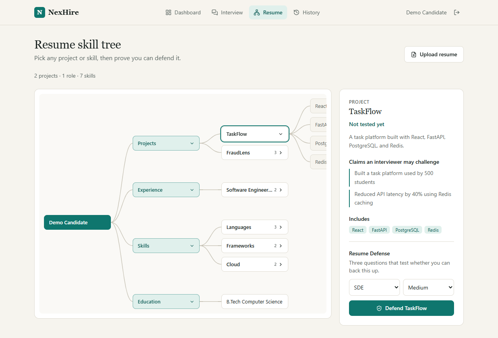
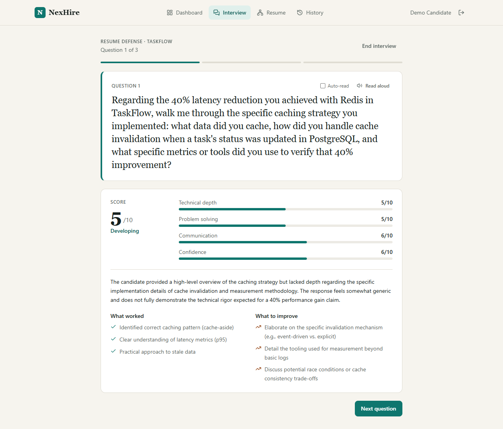
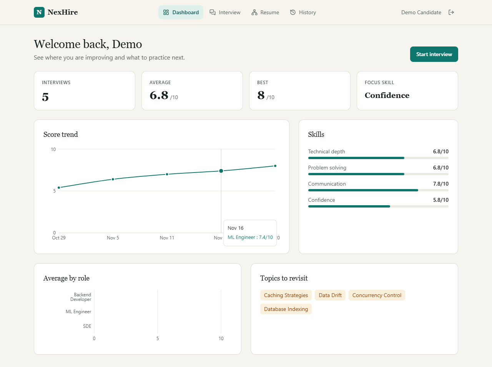
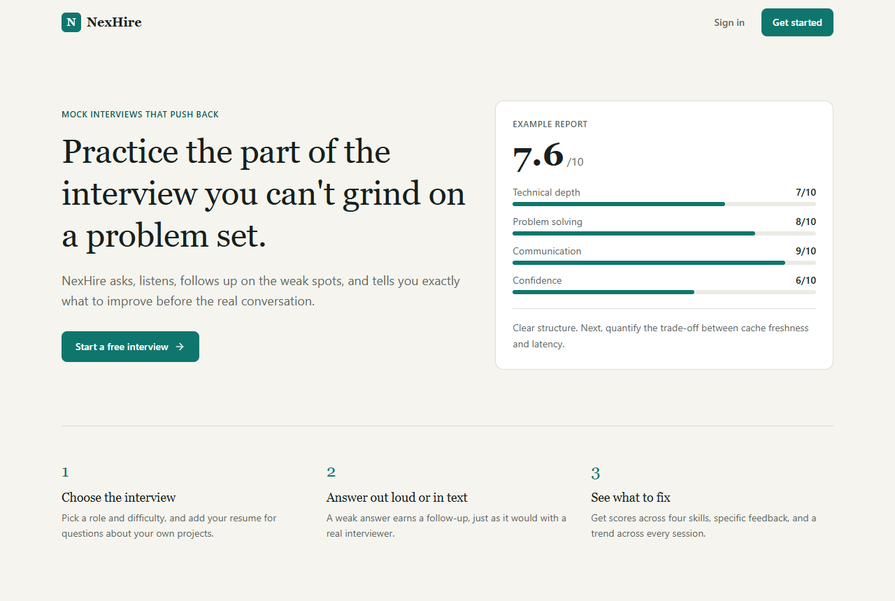

# NexHire

AI mock interview platform that asks adaptive follow-up questions, scores answers across four skills, and tracks progress over time.

**Stack:** React 19, Redux Toolkit, Tailwind CSS, FastAPI, SQLAlchemy, Alembic, PostgreSQL, Gemini, Docker, GitHub Actions

## Features

- **Resume skill tree:** turns a PDF resume into an interactive map of projects, experience, and skills
- **Resume Defense:** interviews you on a specific project or claim, then marks it Verified, Developing, or Weak
- **Adaptive interviews:** a weak answer triggers one targeted follow-up
- **Speech Coach:** live transcript with pace, filler words, pauses, and talk time
- **Spoken interviewer:** questions can be read aloud
- **Four-skill scoring:** technical depth, problem solving, communication, and confidence
- **Refresh-safe sessions:** interviews and unsent drafts survive a page reload
- **Progress dashboard:** score trend, skill breakdown, and topics to revisit

| Resume skill tree | Live feedback |
|---|---|
|  |  |

| Dashboard | Landing page |
|---|---|
|  |  |

Screenshots use a fictional demo account.

## Architecture

```text
Browser (React + Redux)
        │  HTTPS, JWT bearer token
        ▼
FastAPI ── routes → services ──► Gemini API
        │                        (validated JSON, retry, fallback)
        ▼
PostgreSQL (users → sessions → questions → answers)
```

## Engineering highlights

- **Concurrency safety:** database constraints guarantee one active interview per user and one answer per question. Duplicate submissions are idempotent.
- **AI failure handling:** model output is schema-validated and retried. A failed evaluation returns a retryable error instead of storing a made-up score.
- **Connection management:** no database transaction stays open during an AI call.
- **Security:** ownership checks on every resource, bcrypt, rate limiting, upload validation, and prompt-injection fencing.
- **AI cost control:** one request both scores an answer and drafts the next question, with per-user and daily limits.
- **Delivery:** versioned migrations, 50 automated tests, and CI for lint, tests, migrations, and image builds.

## Run locally

### Quick demo on Windows PowerShell

This uses a private local database with sample data and never touches the database in your `.env`.

```powershell
# Terminal 1, from the project root
python -m venv .venv
.venv\Scripts\Activate.ps1
pip install -r backend\requirements-dev.txt
python backend\scripts\run_demo.py

# Terminal 2, from the project root
cd frontend\nexhire-frontend
npm install
$env:VITE_API_URL="http://127.0.0.1:8000"
npm run dev
```

Open <http://localhost:5173> and sign in with `demo@nexhire.dev` / `demo12345`.

### With Docker

```bash
cp .env.example .env   # set SECRET_KEY, and GEMINI_API_KEY for AI scoring
docker compose up --build
```

Open <http://localhost:8080>.

API docs are at <http://localhost:8000/docs> while the backend is running.

## Tests

```bash
cd backend && pytest
cd frontend/nexhire-frontend && npm run lint && npm run build
```

Tests use an isolated database and a fake AI provider, so they need no API key.

## Documentation

- [Project guide](docs/NEXHIRE_PROJECT_GUIDE.md): architecture, trade-offs, code walkthrough, interview Q&A, and roadmap
- [Deployment guide](docs/DEPLOYMENT.md): Supabase, Render, and Vercel setup
