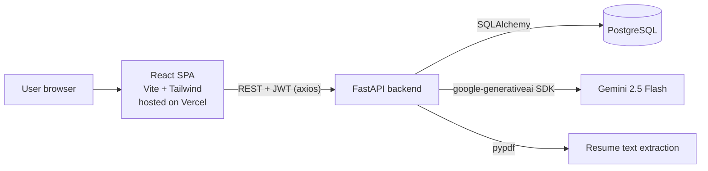
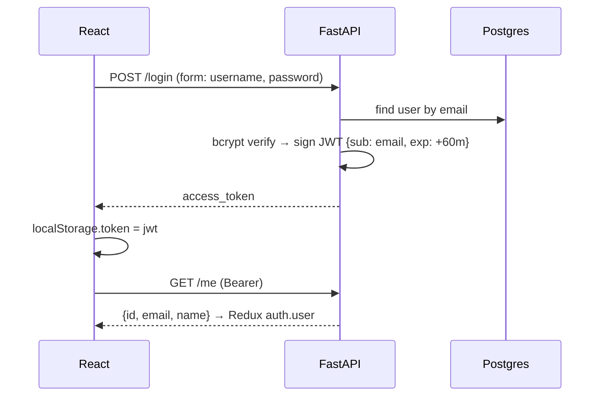

# NexHire — Architecture

NexHire is an **AI mock-interview platform**. A user signs up, picks a role (SDE, ML Engineer, Product Manager) and a difficulty, optionally uploads a PDF resume, and then answers 5 AI-generated questions. Google Gemini generates each question and scores each answer on four dimensions. Results are saved, and the user can review past sessions and see progress on a dashboard.

---

## 1. System overview



| Layer | Tech | Location |
|---|---|---|
| Frontend | React 19, Vite 8, Tailwind 4, Redux Toolkit, React Router 7, Recharts, lucide-react | `frontend/nexhire-frontend/` |
| Backend | FastAPI, SQLAlchemy (sync), Pydantic v2, python-jose (JWT), passlib/bcrypt | `backend/app/` |
| Database | PostgreSQL (psycopg2), Alembic migrations | `backend/alembic/` |
| AI | Google Gemini `gemini-2.5-flash` | `backend/app/services/gemini_service.py` |
| Hosting | Frontend on Vercel (`nexhire-kappa.vercel.app`), SPA rewrite in `vercel.json` | backend host not defined in repo |

---

## 2. Repository layout

```
NexHire/
├── backend/
│   ├── alembic/                 # DB migrations (users, interview tables, resumes, scores)
│   ├── app/
│   │   ├── main.py              # FastAPI app, CORS, /register /login /me, router wiring
│   │   ├── database.py          # engine, SessionLocal, Base (reads DATABASE_URL)
│   │   ├── dependencies.py      # get_db() session-per-request
│   │   ├── auth.py              # bcrypt hashing, JWT create/verify, get_current_user
│   │   ├── models.py            # SQLAlchemy models
│   │   ├── schemas.py           # Pydantic request/response models
│   │   ├── routes/
│   │   │   ├── auth.py          # placeholder router (/auth/test)
│   │   │   ├── interview.py     # start / answer / end / detail / resume upload
│   │   │   ├── history.py       # list sessions, session summary
│   │   │   └── dashboard.py     # aggregated stats
│   │   ├── services/
│   │   │   ├── gemini_service.py   # generate_question, evaluate_answer
│   │   │   ├── resume_services.py  # PDF -> text (pypdf)
│   │   │   └── resume_parser.py    # keyword skill match + regex project extraction
│   │   └── test_*.py            # ad-hoc scripts (not a pytest suite)
│   └── requirements.txt
└── frontend/nexhire-frontend/
    ├── vercel.json              # SPA rewrite to index.html
    └── src/
        ├── App.jsx              # routes
        ├── api/                 # axiosClient (+ JWT interceptor) and per-feature API calls
        ├── store/               # Redux: authSlice, interviewSlice (async thunks)
        ├── layouts/AppLayout.jsx
        ├── pages/               # Login, Register, Dashboard, Interview, History, HistoryDetails
        └── components/          # RoleSelector, QuestionCard, AnswerInput (voice), FeedbackPanel, SessionSummary, ...
```

---

## 3. Data model

```mermaid
erDiagram
    USERS ||--o{ INTERVIEW_SESSIONS : has
    USERS ||--o{ RESUMES : uploads
    RESUMES |o--o{ INTERVIEW_SESSIONS : "personalises"
    INTERVIEW_SESSIONS ||--o{ QUESTIONS : contains
    QUESTIONS ||--o| ANSWERS : "answered by"

    USERS { string id PK; string email UK; string hashed_password; string name; datetime created_at }
    RESUMES { string id PK; string user_id FK; string filename; text extracted_text; json skills; json projects; datetime uploaded_at }
    INTERVIEW_SESSIONS { string id PK; string user_id FK; string resume_id FK; string role; string difficulty; string status; float total_score; datetime created_at; datetime completed_at }
    QUESTIONS { string id PK; string session_id FK; text question_text; int question_order; datetime created_at }
    ANSWERS { string id PK; string question_id FK; text answer_text; int score; int communication_score; int technical_depth_score; int problem_solving_score; int confidence_score; text feedback; text strengths; text improvements; datetime created_at }
```

- All IDs are UUID strings.
- `status` is `active` → `completed`.
- `strengths` / `improvements` are stored as a JSON array in a Text column (`app/utils.py` `dump_list` / `load_list`). Older rows used `", "`-joined text; `load_list` reads both.
- Schema is created two ways: Alembic migrations **and** `Base.metadata.create_all()` at app startup.

---

## 4. API reference

All routes except `/`, `/register`, `/login` need `Authorization: Bearer <jwt>`.

| Method | Path | Purpose |
|---|---|---|
| POST | `/register` | Create user (`email`, `password`, `name`) |
| POST | `/login` | OAuth2 form (`username`=email, `password`) → `{access_token}` (60 min, HS256) |
| GET | `/me` | Current user |
| POST | `/interview/upload` | Multipart PDF → extract text, skills, projects → `resume_id` |
| POST | `/interview/start` | `{role, difficulty, resume_id?}` → new session + first question |
| POST | `/interview/answer` | `{session_id, question_id, answer}` → scores + feedback + next question (null after Q5) |
| POST | `/interview/end` | `{session_id}` → averages score, marks completed |
| GET | `/interview/{session_id}` | Full session with Q&A and feedback |
| GET | `/history/` | List user's sessions (newest first) |
| GET | `/history/{session_id}` | One session summary |
| GET | `/dashboard/stats` | Avg score by role, score over time, top 5 "weak topics" |

---

## 5. End-to-end flows

### 5.1 Auth



- `axiosClient` attaches the token on every request; any `401` clears it and redirects to `/login`.
- `ProtectedRoute` only checks that a token **exists** (not that it is valid).

### 5.2 Interview

```mermaid
sequenceDiagram
    participant FE as InterviewPage (Redux)
    participant BE as /interview
    participant G as Gemini
    participant DB as Postgres

    opt Resume
      FE->>BE: POST /upload (PDF)
      BE->>BE: pypdf text → keyword skills, regex projects
      BE->>DB: insert resume
      BE-->>FE: resume_id, skills, projects
    end
    FE->>BE: POST /start {role, difficulty, resume_id}
    BE->>DB: insert session
    BE->>G: generate_question(role, difficulty, resume)
    BE->>DB: insert question #1
    BE-->>FE: session_id, question
    loop up to 5 questions
      FE->>BE: POST /answer {session_id, question_id, answer}
      BE->>G: evaluate_answer → JSON scores
      BE->>DB: insert answer
      alt fewer than 5 questions
        BE->>G: generate_question(role, difficulty)
        BE->>DB: insert next question
      end
      BE-->>FE: feedback + next_question (or null)
    end
    FE->>BE: POST /end
    BE->>DB: total_score = avg(answer.score); status=completed
    BE-->>FE: total_score, strengths, improvements
```

**Frontend state machine** (`interviewSlice`): `idle` → (`startInterview`) → `active` → show question → `submitAnswer` → show `FeedbackPanel` → `loadNextQuestion` … → `endInterview` → `completed` → `SessionSummary`.

`AnswerInput` supports voice answers through the browser Web Speech API.

### 5.3 AI layer (`gemini_service.py`)

- **generate_question** — prompt includes role, difficulty, resume skills/projects, and every question already asked in the session. Returns `None` on error; the route (`_next_question_text`) then picks an unused canned question for that role.
- **evaluate_answer** — asks for strict JSON (`score`, `communication`, `technical_depth`, `problem_solving`, `confidence` 0–10, `strengths[]`, `improvements[]`, `feedback`). Strips code fences, `json.loads`, clamps scores to 0–10 integers. On any failure returns neutral 5/10 scores.

**Interview rules enforced by the API:** a question must belong to the session, each question can be answered once (409), a finished interview can't take answers (400), and a resume can only be used by its owner (404).

**Frontend persistence:** the interview Redux slice is saved to `localStorage` (`nexhire_interview`), so a refresh resumes the interview. It's cleared on logout, on a 401, and when leaving the summary screen. The navbar re-fetches `/me` after a refresh.
- Calls are **synchronous and blocking** inside request handlers.

### 5.4 History & dashboard

- History lists sessions; details page calls `GET /interview/{id}`.
- Dashboard computes everything in Python per request: per-role averages, score timeline, and "weak topics" = most frequent comma-split `improvements` entries.

---

## 6. Configuration

| Var | Where | Purpose |
|---|---|---|
| `DATABASE_URL` | backend `.env` | Postgres connection string |
| `SECRET_KEY` | backend `.env` | JWT signing key |
| `GEMINI_API_KEY` | backend `.env` | Gemini access |
| `VITE_API_URL` | frontend env | Backend base URL |

CORS origins are hard-coded in `main.py` (localhost:5173 and the Vercel URL).

### Running locally

```bash
# backend
cd backend
pip install -r requirements.txt
alembic upgrade head
uvicorn app.main:app --reload

# frontend
cd frontend/nexhire-frontend
npm install
npm run dev
```

---

## 7. Known issues & tech debt

### Fixed (Nov 2026)
- Timestamps were frozen at server start (`default=datetime.now(UTC)` evaluated once); now a lambda.
- Questions 2–5 ignored history and resume, so they could repeat; both are now passed to Gemini, and fallbacks never repeat.
- Missing ownership checks on question / resume; duplicate answers and answers after the interview ended were allowed.
- Detail endpoint dropped the four sub-scores.
- Dashboard "weak topics" split sentences on commas; the score timeline wasn't sorted.
- Interview and user name were lost on page refresh; "Start new interview" on the summary showed the old summary again.
- Progress bar had 3 dots for 5 questions; API errors showed generic axios text.
- A wrong password reloaded the login page (401 interceptor), hiding the error.
- 422 validation errors crashed the login/register pages (React tried to render the error list).
- `venv/` and `__pycache__/` untracked; `requirements.txt` converted from UTF-16 and pinned; `DATABASE_URL` no longer printed.

### Still open
- `create_all()` at startup competes with Alembic — pick Alembic only (check the backend host's deploy steps first).
- Empty `routes/auth.py` while auth lives in `main.py`; duplicate imports in `main.py`.
- `google-generativeai` is the deprecated SDK; the successor is `google-genai`.
- No automated tests (`test_*.py` are manual scripts), no CI, no backend deploy config in the repo.
- Gemini calls block the worker; no rate limiting on AI endpoints.
- `ProtectedRoute` only checks that a token exists; JWT expiry (60 min) logs the user out mid-interview.
- Weak topics are still whole AI sentences; topic tagging per question would make them useful.
