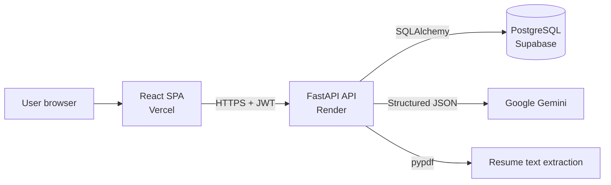
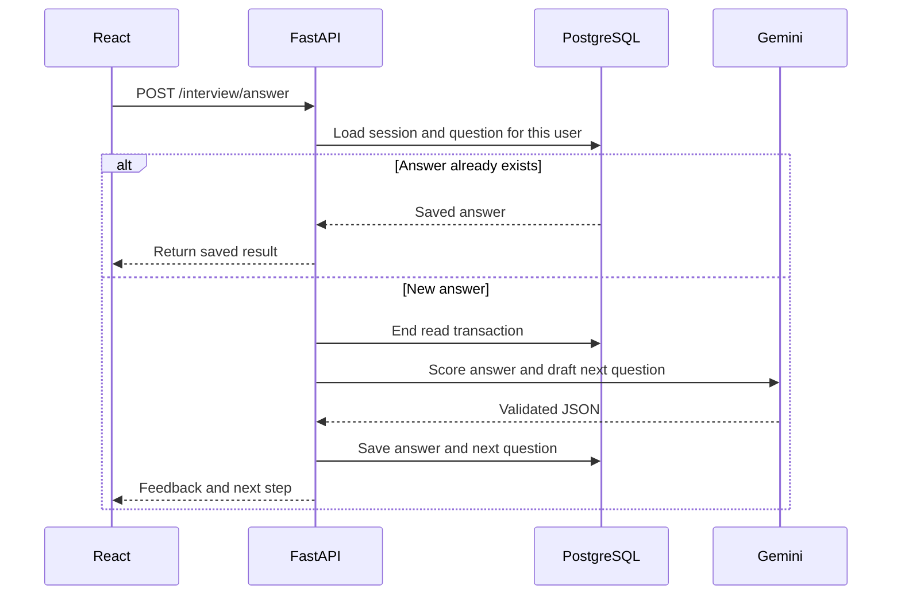
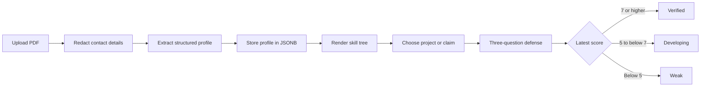

# NexHire Architecture

NexHire is an AI mock interview platform. A user can upload a resume, explore it as a skill tree, defend a specific project or claim, and track scored progress over time.

## 1. System overview



| Layer | Technology | Location |
|---|---|---|
| Frontend | React 19, Vite, Redux Toolkit, Tailwind CSS, Recharts, d3-hierarchy | `frontend/nexhire-frontend/` |
| API | FastAPI, Pydantic, SQLAlchemy, python-jose, passlib/bcrypt | `backend/app/` |
| Database | PostgreSQL with JSONB and Alembic migrations | `backend/alembic/` |
| AI | Gemini through the `google-genai` SDK | `backend/app/services/gemini_service.py` |
| Delivery | Docker Compose, GitHub Actions, Render, Vercel | repository root |

## 2. Repository layout

```text
NexHire/
├── backend/
│   ├── alembic/                  # Versioned schema migrations
│   ├── app/
│   │   ├── main.py               # App setup, CORS, request IDs, /health, /ready
│   │   ├── config.py             # Validated environment settings
│   │   ├── models.py             # Tables, constraints, indexes
│   │   ├── schemas.py            # Request and response contracts
│   │   ├── auth.py               # Password hashing and JWT handling
│   │   ├── limits.py             # Per-user and login limits
│   │   ├── routes/               # HTTP layer
│   │   └── services/             # Interview rules, AI, resume, speech metrics
│   ├── evals/                    # AI scoring benchmark
│   ├── scripts/run_demo.py       # Private local demo with sample data
│   └── tests/                    # Automated backend tests
├── frontend/nexhire-frontend/
│   └── src/
│       ├── api/                  # Axios client and API calls
│       ├── store/                # Auth and interview state
│       ├── pages/                # Route-level screens
│       └── components/           # Interview, resume tree, charts, UI
├── docs/
├── docker-compose.yml
└── render.yaml
```

## 3. Data model

```mermaid
erDiagram
    USERS ||--o{ RESUMES : uploads
    USERS ||--o{ INTERVIEW_SESSIONS : starts
    RESUMES |o--o{ INTERVIEW_SESSIONS : personalizes
    INTERVIEW_SESSIONS ||--o{ QUESTIONS : contains
    QUESTIONS ||--o| ANSWERS : receives

    USERS {
        string id PK
        string email UK
        string hashed_password
        string name
        datetime created_at
    }
    RESUMES {
        string id PK
        string user_id FK
        string filename
        text extracted_text
        json skills
        json projects
        jsonb profile
        datetime uploaded_at
    }
    INTERVIEW_SESSIONS {
        string id PK
        string user_id FK
        string resume_id FK
        string role
        string difficulty
        string status
        float total_score
        float communication_avg
        float technical_depth_avg
        float problem_solving_avg
        float confidence_avg
        text summary
        jsonb focus
        datetime created_at
        datetime completed_at
    }
    QUESTIONS {
        string id PK
        string session_id FK
        text question_text
        int question_order
        boolean is_followup
        datetime created_at
    }
    ANSWERS {
        string id PK
        string question_id FK
        text answer_text
        int score
        int communication_score
        int technical_depth_score
        int problem_solving_score
        int confidence_score
        text feedback
        jsonb strengths
        jsonb improvements
        jsonb weak_topics
        jsonb speech
        datetime created_at
    }
```



| Rule | Enforcement | Why it matters |
|---|---|---|
| One active interview per user | Partial unique index on `user_id` where `status = 'active'` | Two tabs cannot start competing interviews |
| One answer per question | Unique `answers.question_id` | Duplicate submissions are idempotent |
| One question per position | Unique `(session_id, question_order)` | Concurrent requests cannot create duplicate next questions |
| User deletion removes owned data | `ON DELETE CASCADE` | No orphaned personal data |
| Resume deletion keeps history | `ON DELETE SET NULL` | Past interviews remain readable |

## 4. API

Everything except registration, login, `/health`, and `/ready` requires `Authorization: Bearer <token>`.

| Method | Path | Purpose |
|---|---|---|
| POST | `/auth/register` | Create an account |
| POST | `/auth/login` | Return a JWT |
| GET | `/auth/me` | Return the current user |
| POST | `/interview/upload` | Validate and analyze a PDF resume |
| POST | `/interview/start` | Start a standard interview or Resume Defense |
| GET | `/interview/active` | Restore an active interview after refresh |
| POST | `/interview/answer` | Score an answer and prepare the next question |
| POST | `/interview/end` | Complete the session and build its report |
| GET | `/interview/{session_id}` | Read a full session |
| GET | `/resumes` | List the user's resumes |
| GET | `/resumes/{resume_id}/tree` | Read the resume tree and mastery status |
| POST | `/resumes/{resume_id}/analyze` | Rebuild the structured resume profile |
| GET | `/history` | List past sessions |
| GET | `/history/{session_id}` | Read one past session |
| GET | `/dashboard/stats` | Read trends, skill averages, and weak topics |
| GET | `/health` | Check that the process is running |
| GET | `/ready` | Check that the database is reachable |

## 5. Key flows

### Submit an answer



No database transaction stays open during the Gemini call, so slow AI responses do not hold a connection. If evaluation fails, the API returns a retryable error and does not store a made-up score.

### Resume Defense



The chosen claim is copied into `interview_sessions.focus`, so editing or re-analyzing a resume does not change past interviews.

### Adaptive interview

A standard interview has up to 5 questions. An answer scoring below 7 can trigger one targeted follow-up. One Gemini request both evaluates the answer and drafts the next question, which reduces quota use.

### Speech Coach

The browser's Web Speech API creates the transcript. The server calculates pace, filler words, pauses, and talk time from the submitted metrics, so speech coaching adds no paid speech API.

## 6. Reliability and security

- **AI output:** responses are schema-validated, scores are clamped, and transient failures are retried.
- **Quota protection:** each user has per-minute AI limits and 3 interview starts per day by default.
- **Access control:** every session and resume lookup is scoped to the authenticated user.
- **Prompt safety:** user text is fenced as data, and contact details are removed before resume analysis.
- **Uploads:** resumes are limited to 5 MB and validated before parsing.
- **Operations:** each response has an `X-Request-ID`, and `/ready` verifies database access.

## 7. Configuration

| Variable | Required | Purpose |
|---|---|---|
| `DATABASE_URL` | Yes | Runtime PostgreSQL connection |
| `DIRECT_URL` | For migrations | Migration connection |
| `SECRET_KEY` | Yes | JWT signing key, at least 32 characters |
| `GEMINI_API_KEY` | For AI | Gemini access |
| `GEMINI_MODEL` | No | Defaults to `gemini-3.1-flash-lite` |
| `CORS_ORIGINS` | Production | Exact allowed website origins, with no trailing slash |
| `DAILY_INTERVIEWS` | No | Interview starts per user per day, default 3 |
| `VITE_API_URL` | Frontend | API base URL, with no trailing slash |

## 8. Known limitations

- The in-memory rate limiter is correct for one API instance. Multiple instances need Redis.
- Gemini calls run in FastAPI's worker threads. Higher traffic should move them to a job queue.
- The JWT is stored in `localStorage`. A stronger production setup would use short-lived tokens with an HttpOnly refresh cookie.
- Render's free service sleeps when idle, so the first request can take up to a minute.
